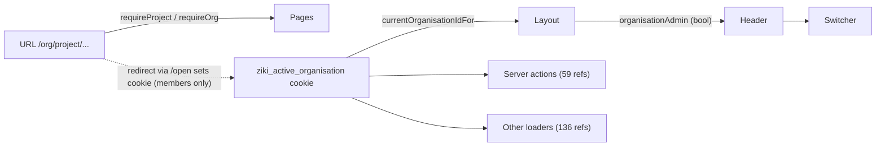
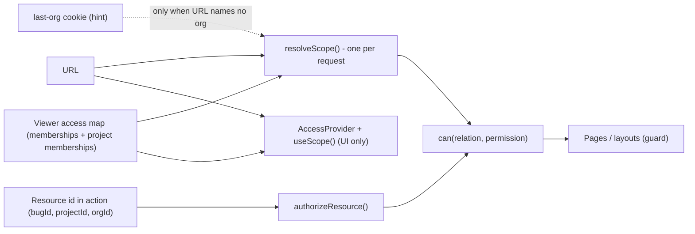

# Solution: Centralized Org/Project Access & Routing for Members and External Contributors

> Reviews and builds on `ORG_AND_PROJECT_ROUTING_ANALYSIS.md`. Everything below was checked against the
> current code (`middleware.ts`, `app/(app)/layout.tsx`, `lib/project-route.ts`,
> `lib/organisation-context.ts`, `lib/organisation-access.ts`, `components/app-header.tsx`,
> `components/organisation-switcher.tsx`, `app/(app)/[org]/**`, `app/actions/**`).

---

## 1. TL;DR

The three symptoms in the analysis (two lookalike "Manage" items, the external-contributor privilege leak,
org settings sitting under a project) are real. But they all come from **one deeper cause the analysis
doesn't name**:

> **There are two competing sources of truth for "which organisation am I in?"**: the **URL**
> (`/<org>/<project>/…`) and the **`ziki_active_organisation` cookie** (`currentOrganisationIdFor`). They
> are kept in sync by redirect side effects, and code reaches for whichever one is closest.

The cookie is read in **195 places across 78 files** (59 of them in `app/actions`). Any time the URL and the
cookie disagree (an external contributor, a public project, two tabs open on different orgs, a URL typed
by hand), each of those places can pick the wrong org.

**The fix is to make access a single layer, not a set of patches:**

1. **The URL is the only authority** on org-scoped routes. The cookie is demoted to a "last used org"
   hint, read only on routes that don't name an org (`/home`, `/inbox`, …).
2. **One resolver** (`resolveScope`) turns *(viewer, URL)* into a typed `AccessScope`: org, project,
   **relation** (`owner | admin | member | contributor | public | none`), and **capabilities**.
3. **One policy table** (`can(relation, permission)`) is the only place permission rules live.
4. **Pages authorize by URL; server actions authorize by the resource they touch**. Neither ever uses
   the cookie.
5. The **header and switcher render from the same scope**, derived on the client from the URL plus a
   user-level access map. That keeps them correct after soft navigation, with no prop drilling and no
   `organisationAdmin` booleans.

With this in place, switching orgs (from the switcher *or* by typing a URL) is just navigating to
`/<slug>`. Everything else follows from the URL.

---

## 2. Review of the Existing Analysis

### 2.1 What the analysis gets right ✅

| Finding | Verdict |
|---|---|
| Issue 1: "Manage organisation" vs "Manage organisations" with the same gear icon (`organisation-switcher.tsx` L262–308) | ✅ Confirmed. The rename and icon change are good. |
| Issue 2: `layout.tsx` L108–115 falls back to `currentOrganisationIdFor` when the route org isn't a membership, so `membershipRole` comes from the *personal* org and `organisationAdmin` is `true` | ✅ Confirmed, and the step-by-step trace is accurate. |
| Issue 3: `orgPath()` builds `/<org>/<project>/org`, so org admin depends on a project existing and needs a synthetic `firstProjectRefFor` | ✅ Confirmed. Settings URLs also change as you switch projects. |
| Target hierarchy (`/<org>`, `/<org>/settings/*`, `/<org>/<project>/*`) | ✅ Correct, and in line with GitHub/Linear/Vercel. |
| QA matrix | ✅ A good start (extended in §7). |

### 2.2 Gaps and corrections ⚠️

| # | Gap | Why it matters |
|---|---|---|
| G1 | **Step 1.1 only fixes the case where the user is a contributor.** It checks `externalProjects` against the route org. A signed-in user viewing a **public project in an org they have no relation to** isn't in `externalProjects` either, so `matchedOrg` is still `null`, the code still falls back to the personal org, and `organisationAdmin` is still `true`. | The leak survives for every public project. The rule has to be: *if the URL names an org, the role comes only from membership in that org. Never fall back.* |
| G2 | **The URL-vs-cookie split isn't identified.** `requireProject`/`requireOrg` change the cookie by redirecting through `/projects/<slug>/open` and `/organisations/open` (a GET request with a side effect). External contributors are deliberately *not* switched (`project-route.ts` L120 only switches when `isOrgMember`), so for them the cookie keeps pointing at the personal org. | Explains the leak, and also: **two tabs on different orgs**. Tab B's visit flips the cookie, so actions submitted from Tab A (`audit.ts`, `jobs.ts`, `duplicates.ts`, `idea-verdicts.ts`, `marketing-settings.ts`, most of `issues.ts`) run against Tab B's org. |
| G3 | **The shell goes stale on soft navigation.** `app/(app)/layout.tsx` works out the org from `x-ziki-path`. In the App Router, layouts above the changed segment **are not re-rendered on client-side navigation**. `(app)/layout` has no params, so going from `/acme/web` to `/globex/api` with `<Link>` keeps the old `organisationAdmin`, dock agents, member count, and so on. The switcher half-works around this with `useParams()`. | Any fix that only patches `layout.tsx` will still show wrong admin links after an in-app navigation. Scope-dependent UI needs to be derived from the URL on the client, or live under the `[org]` segment. |
| G4 | **The redirect mapping in Step 2.3 is wrong for one section.** `/:org/:project/org/:section` → `/:org/settings/:section` sends the existing `/org/settings` page to `/<org>/settings/settings`. The existing sections are also `agents, invites, members, milestones, projects, settings, types`, and the target table only lists three. The file is `next.config.ts`, not `.mjs`. | Broken deep links after the move. |
| G5 | **Project settings live at `/projects/[slug]/settings`**, which identifies the project by its slug alone and resolves it through the cookie org. Two orgs can each have a `web` project. | The same ambiguity, in another place. The target table lists `/<org>/<project>/settings` but there's no migration step for it. |
| G6 | **Hiding a link isn't authorization.** Phase 1 is all UI. The analysis doesn't say who blocks an external contributor who types `/<org>/settings`. | Needs a server guard on the segment and in each page/action. |
| G7 | **External orgs can't be switched to.** The switcher lists only membership orgs. External orgs appear only as the "selected" label when you're already on that URL. | External contributors have no way to switch between their contributions. |
| G8 | `organisations/actions.ts → orgSettingsPath()` builds the post-action redirect from the **Referer** header. | Fragile. Once routes are deterministic, build it from the org slug. |
| G9 | `[org]/[project]/layout.tsx` shows the breadcrumb only when the project belongs to the **cookie** org *and* the user is a member. | Contributors and public viewers lose the breadcrumb. Same root cause. |

### 2.3 What the codebase already does well 👍

These are good foundations. The solution extends them rather than replacing them.

- **Project pages already treat the URL as the source of truth** (#project-urls). `requireProject()` is a
  real, request-cached (`React.cache`) resolver that returns `isOrgMember / isProjectMember / isOrgAdmin /
  canContribute`. That's the right shape. It just needs to become *the* model for everything.
- **404 rather than 403** for things you can't see ("a project you can't see looks the same as one that
  doesn't exist"). This avoids leaking which orgs and projects exist. Keep it.
- **Roles are scoped to membership.** `isOrganisationAdmin` deliberately doesn't let a site-wide `admin`
  carry over into orgs. Only `super_admin` crosses tenants.
- **Org admin actions take an explicit `organisationId`** (rename, archive, invites, share links) and
  re-check membership in `lib/organisations.ts` / `lib/invites.ts`, not via the cookie. This is the
  correct pattern for actions.
- **`middleware.ts` overwrites `x-ziki-path` / `x-ziki-url`**, so a client can't spoof them. The
  `/open` routes use `safeNext()` to block open redirects.
- **`settings` is already a reserved project slug** (`lib/project-slug.ts` L55), and org slugs avoid
  reserved top-level names (`organisationSlugCandidate`). So `/<org>/settings` doesn't collide with
  anything today.
- **`/organisations/open` already handles orgs with no projects**, and `canContributeToProject()`
  already centralizes the contributor rule for issue creation.
- **`ProjectRef` is a branded type** with path helpers, which makes renaming routes mechanical.

---

## 3. Root Cause Model



The arrows from the cookie into the layout, actions and loaders are where URL and cookie diverge.
The dotted arrow is the only thing keeping them in sync, and it skips external contributors and public
viewers on purpose.

**Target:**



---

## 4. Target Design

### 4.1 Principles (put these in `AGENTS.md`)

1. **The URL decides the org and project.** A route that names an org (`/<org>/…`) never reads the
   cookie for scoping.
2. **Relations come only from data.** Relation is computed from `Membership` / `ProjectMembership` /
   `visibility` for *that* org and project. No fallback to another org.
3. **One policy table.** Permission checks call `can()`. No inline role comparisons
   (`role === "owner" || …`) in pages or actions.
4. **Pages authorize by URL, actions authorize by resource.** An action receives an id, loads the
   resource's `organisationId`/`projectId`, and authorizes that.
5. **The client never authorizes.** Client capabilities only decide what to *show*. The server
   re-checks everything.
6. **Deny by default.** Unknown relation means `none`, which means 404.

### 4.2 Relations and the policy table

New file: `lib/access/policy.ts`. Pure and framework-free, so it's trivial to unit test.

```ts
/** How the viewer relates to the org/project the URL names. Super admin resolves to "owner". */
export type Relation = "owner" | "admin" | "member" | "contributor" | "public" | "none";

const MEMBER = ["owner", "admin", "member"] as const;
const ADMIN = ["owner", "admin"] as const;

export const PERMISSIONS = {
  // Organisation scope
  "org:view":           [...MEMBER, "contributor"],   // /<org>: contributors see only their projects
  "org:settings:view":  MEMBER,                       // /<org>/settings: read-only for members
  "org:manage":         ADMIN,                        // members, invites, types, milestones, agents
  "org:own":            ["owner"],                    // rename, archive, delete, change roles
  // Project scope
  "project:view":       [...MEMBER, "contributor", "public"],
  "project:contribute": [...MEMBER, "contributor"],   // file issues, comment, bid, claim
  "project:triage":     ADMIN,
  "project:manage":     ADMIN,                        // /<org>/<project>/settings, join requests
} as const satisfies Record<string, readonly Relation[]>;

export type Permission = keyof typeof PERMISSIONS;
export type Capabilities = Record<Permission, boolean>;

export function can(relation: Relation, permission: Permission): boolean {
  return (PERMISSIONS[permission] as readonly Relation[]).includes(relation);
}

export function capabilitiesFor(relation: Relation): Capabilities {
  return Object.fromEntries(
    (Object.keys(PERMISSIONS) as Permission[]).map((p) => [p, can(relation, p)]),
  ) as Capabilities;
}

export const isMemberRelation = (r: Relation) => r === "owner" || r === "admin" || r === "member";
```

Deriving the relation (`lib/access/relation.ts`, also pure):

```ts
export function orgRelation(viewer: ViewerAccess, orgId: string): Relation {
  if (viewer.isSuperAdmin) return "owner";
  const role = viewer.orgRoles.get(orgId);                 // Membership.role
  if (role) return role;
  if (viewer.contributorOrgIds.has(orgId)) return "contributor";
  return "none";
}

export function projectRelation(viewer: ViewerAccess, project: { id: string; organisationId: string; visibility: string }): Relation {
  const org = orgRelation(viewer, project.organisationId);
  if (isMemberRelation(org)) return org;                    // org role wins
  if (viewer.projectIds.has(project.id)) return "contributor";
  if (project.visibility === "public") return "public";
  return "none";
}
```

### 4.3 The viewer access map (one query per request)

`lib/access/viewer.ts`

```ts
export type ViewerAccess = {
  userId: string;
  isSuperAdmin: boolean;
  orgRoles: Map<string, "owner" | "admin" | "member">;      // active orgs only
  orgs: Array<{ id: string; slug: string; name: string; role: "owner" | "admin" | "member" }>;
  projectIds: Set<string>;                                  // ProjectMembership
  contributorOrgIds: Set<string>;                           // orgs reached only via ProjectMembership
  contributions: Array<{ orgId: string; orgSlug: string; orgName: string; projectId: string; projectSlug: string; projectName: string }>;
};

export const loadViewerAccess = cache(async (): Promise<ViewerAccess> => { /* 2 queries in parallel */ });
```

This replaces the separate membership and project-membership queries currently in `layout.tsx`
(L105, L119), `requireProject` (L60, L75) and `requireOrg`. It depends only on the user, never on the
route, so it's safe to compute once in the root layout and hand to the client.

### 4.4 The scope resolver (server)

`lib/access/scope.ts`

```ts
export type OrgInfo = { id: string; slug: string; name: string };
export type ProjectInfo = { id: string; slug: string; name: string; ref: ProjectRef; visibility: "public" | "private"; isOpenForContributors: boolean };

export type AccessScope =
  | { kind: "global"; viewer: ViewerAccess }
  | { kind: "org"; viewer: ViewerAccess; org: OrgInfo; relation: Relation; can: Capabilities }
  | { kind: "project"; viewer: ViewerAccess; org: OrgInfo; project: ProjectInfo;
      orgRelation: Relation; relation: Relation; can: Capabilities };

/** Parses x-ziki-path into { orgSlug, projectSlug } using the reserved top-level segment list. */
export function parseScopedPath(path: string): { orgSlug: string | null; projectSlug: string | null };

/** The scope for this request's URL. Cached per request. */
export const resolveScope = cache(async (): Promise<AccessScope> => { … });

/** Explicit variants for pages that already have params (preferred inside [org] routes). */
export const scopeForOrg = cache(async (orgSlug: string) => { … });
export const scopeForProject = cache(async (orgSlug: string, projectSlug: string) => { … });

/** Guards: 404 when the permission is missing (keeps the existing "can't see == doesn't exist" rule). */
export async function requireOrgScope(orgSlug: string, permission: Permission = "org:view") { … }
export async function requireProjectScope(orgSlug: string, projectSlug: string, permission: Permission = "project:view") { … }
```

`parseScopedPath` must treat the first segment as an org slug **only** if it isn't a reserved top-level
route (`home`, `inbox`, `settings`, `organisations`, `discover`, `projects`, `earn`, …). Reuse
`RESERVED_ORGANISATION_SLUGS` / `isReservedProjectSlug`. Move them to an edge-safe module
(`lib/route-segments.ts`) so `middleware.ts` can share the same list.

### 4.5 Authorizing server actions by resource

`lib/access/authorize.ts`

```ts
export async function authorizeOrg(orgId: string, permission: Permission): Promise<OrgAuthz>;
export async function authorizeProject(projectId: string, permission: Permission): Promise<ProjectAuthz>;
export async function authorizeBug(bugId: string, permission: Permission): Promise<BugAuthz>;
// Each loads the resource's organisationId/projectId/visibility, derives the relation with the same
// functions as §4.2, and returns null (or throws a typed AccessDenied) when `can()` fails.
```

Usage replaces the most common cookie pattern:

```ts
// BEFORE (cookie-scoped, wrong in a second tab, broken for contributors)
const bug = await prisma.bug.findFirst({ where: { id: bugId, ...bugInOrganisation(await currentOrganisationIdFor(user.id)) } });

// AFTER (resource-scoped, one policy)
const authz = await authorizeBug(bugId, "project:triage");
if (!authz) return { error: "Issue not found." };
```

`canContributeToProject()` becomes a thin wrapper around `authorizeProject(id, "project:contribute")`,
so existing callers keep working.

### 4.6 Client: one provider for the header, switcher and nav

The root layout stops computing route-dependent booleans. It passes the **user-level** access map once:

```tsx
// app/(app)/layout.tsx
const viewer = await loadViewerAccess();
<AccessProvider viewer={toClientViewer(viewer)}>   {/* ids, slugs, names, roles: no secrets */}
  <AppHeader … />
  …
</AccessProvider>
```

```ts
// components/access/use-scope.ts  ("use client")
export function useScope(): ClientScope {
  const { org, project } = useParams<{ org?: string; project?: string }>();
  const viewer = useContext(AccessContext);
  // Same parse + relation functions as the server (they're pure), so UI and server always agree.
  // An org/project not in the map resolves to "public" on a project route and "none" otherwise,
  // so admin links stay hidden by default.
  return useMemo(() => deriveClientScope(viewer, org, project), [viewer, org, project]);
}
```

`useParams()` updates on every soft navigation, so the header and switcher are **always in sync with the
address bar**, whether you navigated with the switcher, a link, back/forward, or by typing a URL. This
fixes G3 without re-rendering the layout.

> [!IMPORTANT]
> `useScope().can` only decides what to *show*. Every page and action still calls
> `requireOrgScope` / `requireProjectScope` / `authorize*` on the server.

Data in the shell that depends on the org (dock agents, escalations count, member count) should move
into a small server component rendered under `app/(app)/[org]/layout.tsx`, or be fetched by org id from
the client. Don't compute it in the root layout from a request header.

### 4.7 Switching orgs = navigating

Because the URL is authoritative, switching no longer has to set a cookie first:

| Switcher item | Href | Notes |
|---|---|---|
| A member org | `switchTarget(scope, org)`: the same sub-page if allowed (`/acme/settings/members` → `/globex/settings/members` when `org:settings:view`), else `/<slug>` | A plain `<Link>`. No server action, no redirect chain. |
| An external org ("Contributing to") | Its one project, or `/<slug>` filtered to their projects | The cookie is never written for orgs you aren't a member of. |
| Public org you're viewing | Read-only label "Viewing · public" | No admin actions. |

Remembering the last-used org (for `/home`): render
`<RememberOrganisation orgId={…} />` under `[org]/layout.tsx` **only when the relation is a membership
and it differs from the cookie**. It posts to a tiny route handler (`POST /organisations/remember`) that
re-checks membership and sets the cookie. That's one background request, with no redirect and no side
effect on GET.

### 4.8 Route map (final)

| Route | Guard (server) | Notes |
|---|---|---|
| `/organisations`, `/discover`, `/home`, `/inbox` | signed-in | Global. Cookie hint allowed. |
| `/<org>` | `org:view` | Members: all projects. Contributors: only their projects (or redirect if there's just one). `none` → 404. |
| `/<org>/settings` | `org:settings:view` | Members read-only, admins edit. |
| `/<org>/settings/{members,invites,projects,types,milestones,agents}` | `org:manage` for write and invites, `org:settings:view` for read | Moved from `/<org>/<project>/org/*`. |
| `/<org>/<project>/…` | `project:view` (pages), `project:contribute` (forms) | `requireProject` becomes a wrapper over `requireProjectScope`. |
| `/<org>/<project>/settings` | `project:manage` | Moved from `/projects/[slug]/settings` (G5). |

---

## 5. Behaviour Matrix: Switcher and Typed URLs

| Viewer → URL | `/acme` | `/acme/settings` | `/acme/web` | Switcher shows | Org settings link |
|---|---|---|---|---|---|
| Owner/Admin of Acme | ✅ all projects | ✅ editable | ✅ full | Acme selected | ✅ `/acme/settings` |
| Member of Acme | ✅ all projects | ✅ read-only | ✅ contribute | Acme selected | ❌ |
| Contributor on Acme/web | ✅ only `web` | 404 | ✅ contribute | Acme under "Contributing to" | ❌ |
| Signed-in, no relation, `web` public | 404 (or public listing, see §8 D2) | 404 | ✅ read-only | "Viewing · public" | ❌ |
| Signed-in, no relation, private | 404 | 404 | 404 | user's last org | ❌ |
| Super admin | ✅ | ✅ editable | ✅ full | Acme selected | ✅ |
| Owner, Acme has 0 projects | ✅ "create first project" | ✅ | n/a | Acme selected | ✅ (no synthetic slug) |
| Two tabs: Acme and Globex | Each tab's actions act on its own URL's org | | | Each tab correct | |
| Legacy `/acme/web/org/members` | 308 → `/acme/settings/members` | | | | |

---

## 6. Execution Plan

Each phase can be shipped on its own and leaves the app working. Phases 1–2 fix the reported bugs.
Phases 3–5 remove the root cause.

### Phase 0: Safety net (do first)

| Step | Work | Files | Done when |
|---|---|---|---|
| 0.1 | Seed fixtures: `owner`, `admin`, `member`, `contributor` (ProjectMembership only), `stranger`, `super_admin`. Orgs: `acme` (public `web`, private `api`), `globex`, `empty` (0 projects). | `prisma/seed*`, `e2e/fixtures` | Fixtures load in CI. |
| 0.2 | Playwright spec encoding the matrix in §5, including **typed URLs** and the **two-tab** case. Mark future-state cases `test.fixme`. | `e2e/org-access.spec.ts` | Current behaviour recorded. The leak case is a failing `fixme`. |

### Phase 1: Central access core (no behaviour change)

| Step | Work | Files | Done when |
|---|---|---|---|
| 1.1 | Add `Relation`, `PERMISSIONS`, `can`, `capabilitiesFor`, `isMemberRelation`. | `lib/access/policy.ts` | 100% unit coverage of the table. |
| 1.2 | Add pure `orgRelation` / `projectRelation`. | `lib/access/relation.ts` | Unit tests for every relation, including super admin and archived orgs. |
| 1.3 | Move reserved segments to an edge-safe module. Add `parseScopedPath`. | `lib/route-segments.ts`, `lib/access/scope.ts` | `/home`, `/settings/agents`, `/acme`, `/acme/web/issues` parse correctly. |
| 1.4 | `loadViewerAccess` (cached, 2 parallel queries, archived orgs and projects excluded). | `lib/access/viewer.ts` | |
| 1.5 | `resolveScope`, `scopeForOrg`, `scopeForProject`, `requireOrgScope`, `requireProjectScope`. | `lib/access/scope.ts` | Unit and integration tests. 404 via `notFound()`. |
| 1.6 | `authorizeOrg/Project/Bug`. Re-implement `canContributeToProject` and `canManageProject` on top of them. | `lib/access/authorize.ts`, `lib/project-permissions.ts` | Existing tests pass. |
| 1.7 | Re-implement `requireProject()` on `requireProjectScope()`, keeping its return shape (`isOrgMember`, `isOrgAdmin`, `canContribute`, …) so ~40 callers don't change. Keep the `switchTo` redirect for now. | `lib/project-route.ts` | Existing tests pass. |

### Phase 2: Fix the header and switcher (closes Issues 1 & 2)

| Step | Work | Files | Done when |
|---|---|---|---|
| 2.1 | `AccessProvider` + `useScope()` (client). Reuse the pure functions from 1.2/1.3. | `components/access/*` | |
| 2.2 | Root layout: pass `viewer` to `AccessProvider`. **Delete** the `routeOrg`/`matchedOrg`/`membershipRole` block (L108–115) and the `organisationAdmin`, `activeOrganisationId`, `externalProjects` props. | `app/(app)/layout.tsx`, `components/app-header.tsx` | No route parsing left in the layout. |
| 2.3 | Switcher reads `useScope()`. Sections: **Your organisations** (member orgs), **Contributing to** (external orgs and their projects), a "Viewing · public" label when relevant. Items are `<Link href={switchTarget(...)}>`. | `components/organisation-switcher.tsx`, `lib/access/switch-target.ts` | G7 closed. |
| 2.4 | Footer actions, as the analysis proposes but gated on `scope.can["org:manage"]`: **Organisation settings** (cog) → the existing `orgPath(ref)` for now (`/<org>/settings` after Phase 3); **Discover projects** (compass); divider; **All organisations** (grid icon, not a gear) → `/organisations`; **Add organisation** (+). | same | Issue 1 closed. No two items share an icon. |
| 2.5 | `[org]/[project]/layout.tsx` breadcrumb uses `scopeForProject` (shown for any relation with `project:view`). | | G9 closed. |
| 2.6 | Move org-dependent shell data (dock agents, escalations, member count) into a server component under the org segment, keyed by the scope's org id. Return nothing when the relation isn't a membership. | `app/(app)/[org]/layout.tsx` (new), `components/agents-dock*` | Contributors don't see their personal org's agents inside Acme. |

✅ Turn on the Phase 0 e2e cases for the external contributor, the public viewer, and soft navigation between orgs.

### Phase 3: Route normalization (closes Issue 3)

| Step | Work | Files | Done when |
|---|---|---|---|
| 3.1 | New `app/(app)/[org]/layout.tsx` guard: `await requireOrgScope(params.org, "org:view")`. Layouts don't run on every soft navigation and aren't a security boundary, so **each page/action under it still calls its own guard** (cheap, because it's cached). | | |
| 3.2 | Move `app/(app)/[org]/[project]/org/*` → `app/(app)/[org]/settings/*`. Layout guard: `org:settings:view`. Invites/members-write pages: `org:manage`. Replace `loadOrg()` (cookie) with `scopeForOrg(params.org)`. | `app/(app)/[org]/settings/**`, delete `org-context.ts` | Works for an org with 0 projects. |
| 3.3 | Path helpers: add `orgSettingsPath(orgSlug, section?)`, `projectSettingsPath(ref)`. Mark `orgPath(ref, …)` `@deprecated` and update its **19 callers** (`settings-nav.tsx`, `app-header.tsx`, `issues-list.tsx`, `organisations/*`, `projects/*`, `milestones/page.tsx`, `settings/page.tsx`, `project-join-requests.ts`). `SettingsNav` takes `orgSlug`, not `orgRef`. | `lib/project-paths.ts`, callers | `orgPath` has no callers left. Delete it. |
| 3.4 | Org admin actions redirect with `orgSettingsPath(org.slug, …)` from the org they acted on. Remove the Referer-based `orgSettingsPath()` / `refererProjectRef` use. | `app/(app)/organisations/actions.ts`, `app/(app)/projects/actions.ts` | G8 closed. |
| 3.5 | Redirects in **`next.config.ts`**, **specific rules before generic ones**, and excluding reserved first segments:<br>`/:org/:project/org/settings` → `/:org/settings`<br>`/:org/:project/org/:section(members\|invites\|projects\|types\|milestones\|agents)` → `/:org/settings/:section`<br>`/:org/:project/org` → `/:org/settings`<br>`/projects/:slug/settings/:rest*` → handled by a route that resolves the org and redirects to `/<org>/<slug>/settings/...` | `next.config.ts`, `app/(app)/projects/[slug]/settings/page.tsx` | G4 and G5 closed. Old links land on the right page. |
| 3.6 | Move project settings to `app/(app)/[org]/[project]/settings/*` with the `project:manage` guard. Update `ProjectIconLinks settingsHref` in `issues-list.tsx` L1574. | | |
| 3.7 | Drop the synthetic `defaultProjectSlug` / `firstProjectRefFor` from the header (keep it only for the `/home` landing redirect). Remove `"org"` from `PROJECT_PAGES` in `project-paths.ts` once the 308s are live. Don't add `settings` there. | `app-header.tsx`, `layout.tsx`, `lib/project-paths.ts` | |

### Phase 4: The URL is authoritative on the server

| Step | Work | Files | Done when |
|---|---|---|---|
| 4.1 | Make `currentOrganisationIdFor` route-aware. All 195 call sites become correct for members in one change:<br>`scope.kind !== "global"` and member relation → `scope.org.id`<br>`scope.kind !== "global"` and non-member → **cookie (legacy, flagged)** for now, `null` after Phase 5<br>`global` → validated cookie (as today) | `lib/organisation-context.ts` | Two-tab e2e passes for members. |
| 4.2 | Remove the GET side-effect redirects: `switchTo()` in `requireProject` and the redirect in `requireOrg`. Add `<RememberOrganisation>` + `POST /organisations/remember` (membership re-checked). | `lib/project-route.ts`, `app/(app)/organisations/remember/route.ts` | Typed URLs load directly, without bouncing through `/open`. `/home` opens the last member org you visited. |
| 4.3 | Keep `/projects/[slug]/open` and `/organisations/open` as compatibility routes for old links only. They now just redirect to `next`. | | |

### Phase 5: Actions authorize by resource (removes the cookie as an authority)

| Step | Work | Files | Done when |
|---|---|---|---|
| 5.1 | Replace `bugInOrganisation(await currentOrganisationIdFor(...))` lookups with `authorizeBug(bugId, perm)`. Start with the write paths: `issues.ts` (≈12 sites), `comments.ts`, `duplicates.ts`, `idea-verdicts.ts`, `confirmations.ts`, `issue-bids.ts`, `bulk-close.ts`, `withdraw-issue.ts`. | `app/actions/*` | Contributors can act on external projects per the policy, and nobody can act outside it. |
| 5.2 | Org-scoped actions that read the cookie (`audit.ts`, `jobs.ts`, `marketing-settings.ts`, `agent-requests.ts`, `webhooks.ts`, `settings.ts`): take an explicit `organisationId` / `orgSlug` from the form (or the bound action argument) and call `authorizeOrg(id, perm)`. | | |
| 5.3 | Replace inline role checks (`role: { in: ["owner","admin"] }`, `isOrganisationAdmin(...)` in pages) with `can()`. | grep-driven | `rg "in: \[\"owner\", \"admin\"\]"` only matches inside `lib/access`. |
| 5.4 | Lint guard: `no-restricted-imports` bans `currentOrganisationIdFor` / `currentOrganisationAccess` in `app/actions/**` and `app/(app)/[org]/**`, and bans the deprecated `orgPath`. | `eslint.config.mjs` | CI fails on regressions. |
| 5.5 | Flip the 4.1 non-member fallback from cookie to `null`. | `lib/organisation-context.ts` | Full e2e matrix is green. |

### Phase 6: Docs and cleanup

- Add §4.1's principles and a short "how to guard a new page/action" recipe to `AGENTS.md` and `CONTRIBUTING.md`.
- Delete `app/(app)/[org]/[project]/org/`, `org-context.ts`, and `organisationAdmin` plumbing.
- Mark `ORG_AND_PROJECT_ROUTING_ANALYSIS.md` as superseded by this document.

---

## 7. Test Plan

**Unit (Vitest)**
- `policy.test.ts`: every `(relation × permission)` cell (6 × 8 = 48 assertions, table-driven).
- `relation.test.ts`: org role beats project membership; super admin resolves to owner; archived org resolves to none; public private-project combinations.
- `scope.test.ts`: `parseScopedPath` with reserved segments, URL-encoded slugs, trailing slashes.
- `switch-target.test.ts`: keeps the sub-page when allowed, otherwise falls back to `/<slug>`.

**E2E (Playwright), extending the analysis's QA matrix**

| # | Scenario | Expectation |
|---|---|---|
| 1 | Admin opens the switcher on `/acme/web` | "Organisation settings" → `/acme/settings`. Icons are distinct. |
| 2 | Member on `/acme/web` | No "Organisation settings". `/acme/settings` is read-only. |
| 3 | Contributor on `/acme/web` | No settings link. Acme listed under "Contributing to". Typing `/acme/settings` gives 404. |
| 4 | Stranger on public `/acme/web` | Read-only. No settings link. The switcher doesn't show their personal org as Acme's admin. |
| 5 | Stranger types private `/acme/api` | 404 (same page as a non-existent project). |
| 6 | Owner of `empty` | `/empty/settings` works without any project. |
| 7 | Soft navigation from `/acme/web` (admin) to `/globex/x` (member) via `<Link>` | The settings link disappears with no reload. |
| 8 | Two tabs: Acme and Globex; triage an issue in the Acme tab | Acts on Acme. |
| 9 | Old `/acme/web/org/members` and `/acme/web/org/settings` | 308 to `/acme/settings/members` and `/acme/settings`. |
| 10 | Member of Acme types `/acme/web/issues` while the cookie says Globex | Loads directly (no `/open` hop). `/home` then opens Acme. |

---

## 8. Decisions Finalized & Cross-Cutting Scoping Analysis (Project vs Org)

### 8.1 Resolution of Key Architectural Decisions

Following engineering review, the core architectural decisions are finalized as follows:

| # | Topic | Decision | Implementation Specification |
|---|---|---|---|
| **D1** | **Org Settings Access** | **Members Read-Only** | Allowed under `org:settings:view`. Normal members can inspect organisation settings/directory in read-only mode, but mutating controls/buttons are hidden and mutations guarded by `org:manage` / `org:own`. In the switcher menu, "Organisation settings" is shown only if `scope.can["org:manage"]` is true (keeps switcher concise for members). |
| **D2** | **Signed-in Stranger at `/<org>`** | **Return 404** | If a user is not an org member and has no project memberships within `/<org>`, accessing `/<org>` returns `notFound()` (404). Avoids tenant enumeration and cross-org information leakage. |
| **D3** | **Contributor at `/<org>`** | **Redirect if 1 Project, Filtered if >1** | A contributor reaching `/<org>` with only 1 contributing project is cleanly redirected (307) directly to `/<org>/<project>/issues`. If they contribute to >1 project within that org, `/<org>` renders a catalog strictly filtered to their accessible projects (never unassociated projects). |
| **D4** | **Shell Data in External Orgs** | **Clean Isolation (No Leak)** | When working inside an external organisation, personal/primary organisation dock agents, escalations, and members are not leaked into the shell. Only personal, un-scoped notifications are rendered. |

---

### 8.2 Architectural Investigation: "Should Feature X be Scoped by Org or Project?"

As Ziki shifts to a project-first collaboration paradigm, key shared features (leaderboard/ranking, escalations, notifications, inbox, agents) must be systematically classified. The table below provides the authoritative scope matrix:

| Feature / Domain | Current Implementation | Optimal Boundary | Architectural Rationale & Implementation Detail |
|---|---|---|---|
| **Leaderboard / Ranking (`/workers`, `/leaderboard`)** | Scoped strictly to `currentOrganisationIdFor` (`PointEntry` aggregated per `organisationId`). | **Hybrid / Dual-Scoped**<br>*(Org primary, Project tab/filter)* | **Points and rewards originate from org budgets**, but external contributors only care about their standings on projects they contribute to.<br>• **Org View (`/<org>/ranking` or `/workers`):** Full org standing for org members.<br>• **Project View (`/<org>/<project>/ranking`):** Shows project contributors and member contributions on that specific project. This gives external contributors a sense of ranking without exposing private org members. |
| **Escalations & Agent Questions (`/inbox/escalations`, `/questions/[id]`)** | Scoped to active org (`bug.organisationId` or agent's org). Counts run by `organisationId`. | **Project-Scoped with Org Rollup** | An escalation stems from an issue or project-scoped agent question.<br>• An issue escalation belongs to `projectId`. Project contributors and triagers should see questions for issues in their project.<br>• Org maintainers get a rollup inbox across all projects.<br>• Contributor inbox only surfaces escalations tied to projects they are members of (`ProjectMembership`). |
| **Notifications & Inbox (`/inbox`, `/inbox/notifications`)** | Filtered by `notificationInOrganisation(orgId)` with fallback for global invites. | **User-centric, tagged by Project & Org** | Notifications are fundamentally personal to the user.<br>• Notifications should carry `projectId` and `organisationId`.<br>• The inbox header badge reflects unread items relevant to the current scope (or global unread when on global tabs), avoiding missing notifications across workspaces. |
| **Agents Dock (`AgentsDock`)** | Loads agents for `dockOrganisationId` (personal/active org). Leaks onto external projects. | **Project/Org Contextual** | • On `/<org>/<project>`, load agents registered to or assigned to that project/org.<br>• If an external contributor is viewing a project without agent permissions, render an empty/compact dock rather than showing their personal org's private agents. |

---

### 8.3 Upstream Synchronization Insights (`upstream/main`)

Inspection of `upstream/main` (commit `757dd275` and PR `#447`) reveals recent changes directly related to this area:
1. **Upstream Hotfix `757dd275` ("remove duplicate Manage organisation link"):**
   Upstream noticed the duplicate gear icon confusion and quickly stripped `Manage organisation` entirely from `components/organisation-switcher.tsx`, leaving only `Manage organisations` (`/organisations`). This was a temporary triage measure, but it left org admins with no direct path to their active org's settings from the header! Our Phase 2 properly disambiguates and reinstates `Organisation settings` (`CogIcon`) vs `All organisations` (`Squares2X2Icon`).
2. **Upstream PR `#447` (`feat/wrong-workspace-redirect`):**
   Upstream added `IssueOrganisationSwitch` (`lib/issue-workspace-switch.ts`, `lib/issue-switch-destination.ts`) so when a user opens an issue link belonging to another org they are a member of, it displays a friendly "Different workspace" prompt rather than a bare 404. Our centralized resolver integrates seamlessly with this pattern, retaining this prompt for valid cross-org member links while preserving 404 for unauthorized viewers.

---

## 9. Risks and Mitigations

| Risk | Mitigation |
|---|---|
| 195 call sites depend on cookie semantics | Phase 4.1 changes the meaning in one function, behind the e2e matrix. Phase 5 migrates actions file by file. The lint rule stops regressions. |
| Layout guards bypassed on soft navigation or direct action POSTs | Guards are cached and also called in every page and action (§4.5, step 3.1). |
| Client and server disagreeing on capabilities | Both use the same pure `relation.ts`/`policy.ts`. The client is display-only. |
| Redirect rules catching non-org paths (`/settings/agents/org`) | Constrain `:org` to exclude reserved segments (regex or `missing` conditions) and test it (e2e #9). |
| Cache staleness after joining or leaving an org or project | Every membership-changing action calls `revalidatePath("/", "layout")` (already done in `enterOrganisation`). Add it to project-join acceptance. |
